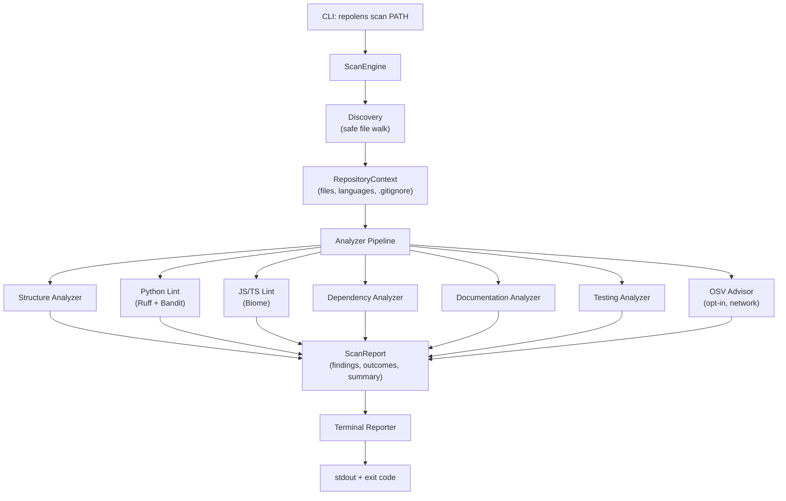

<div align="center">


# RepoLens

**Python 3.11+** &nbsp;•&nbsp; **macOS · Linux · Windows** &nbsp;•&nbsp; **Python · JavaScript · TypeScript** &nbsp;•&nbsp; **License: MIT**

### A clean, native way to verify repository health, hygiene, and security.

RepoLens inspects code quality, dependency manifests, documentation coverage, security anti-patterns, and test suite setup without executing repository code or installing packages. It operates completely offline by default, enforces strict resource limits and secret redaction, and reports deterministic findings with clear exit codes for local development and CI workflows.

> **Status:** Alpha (v0.1.0): Stages 1, 2, and 3 complete. Not yet published to PyPI.

</div>

---

## What it does

RepoLens performs a fully offline, static scan of a repository directory. It runs a pipeline of analyzers against the discovered files and produces a structured report of findings grouped by severity.



### Analyzer categories

| Category | What it checks |
| --- | --- |
| Structure | LICENSE, README, `.gitignore` coverage, unignored vendor or secret directories, manifests, lockfiles, binary bloat |
| Code quality | Python syntax and style via Ruff; JavaScript and TypeScript lint via Biome |
| Security | Python security anti-patterns via Bandit; known vulnerabilities via OSV.dev (opt-in) |
| Dependencies | Manifest and lockfile consistency for Python and npm; version pinning; semver range drift |
| Documentation | Manifest references to missing README or license files; broken relative links in README; SPDX license mismatches |
| Testing | Test directory presence, runner configuration, coverage tooling, pytest declared as a dependency |

---

## Features

- **No code execution.** RepoLens never runs `setup.py`, npm scripts, test suites, or any code from the scanned repository.
- **No automatic installs.** External tools (Ruff, Bandit, Biome) are optional and never installed by RepoLens.
- **Safe discovery.** The file walker rejects symlinks, blocks reads of sensitive files (`.env`, SSH keys, PEM files), enforces per-file and total byte budgets, and applies `.gitignore` rules.
- **Secret redaction.** Evidence and error messages are scrubbed of API keys, tokens, private keys, JWTs, and credential URLs before they enter any report.
- **Fault-isolated analyzers.** A failing or timed-out analyzer never aborts the rest of the scan. Each outcome is recorded independently.
- **Deterministic output.** Findings are deduplicated by SHA-256 fingerprint and sorted by severity, category, location, and rule ID. The same repository always produces the same report.
- **Structured exit codes.** Exit codes distinguish clean scans, detected findings, usage errors, operational failures, and interrupts. CI pipelines can act on each case without parsing output.
- **Programmatic API.** `ScanEngine` and `ScanReport` are fully usable as a library. The CLI is a thin wrapper.

---

## Requirements

- Python 3.11 or later
- Linux, macOS, or Windows

Runtime dependencies:

| Package | Version | Role |
| --- | --- | --- |
| `pydantic` | `>=2.7, <3.0` | Data models and validation |
| `packaging` | `>=24.0, <27.0` | PEP 508 requirement parsing |

Optional external tools (installed separately):

| Tool | Install | Enables |
| --- | --- | --- |
| Ruff | `pip install ruff` | Python lint and syntax checks |
| Bandit | `pip install bandit` | Python security checks |
| Biome | `npm install -g @biomejs/biome` | JavaScript/TypeScript lint |

---

## Installation

RepoLens is not yet published to PyPI. Install it from the repository:

```bash
git clone https://github.com/CalebPiusC/RepoLens.git
cd RepoLens

python3 -m venv .venv
source .venv/bin/activate         # Windows: .venv\Scripts\activate

pip install .                     # installs RepoLens and the repolens command
```

To include Ruff and Bandit for Python analysis:

```bash
pip install ".[tools]"
```

To set up a full development environment:

```bash
pip install -e ".[dev]"
```

---

## Usage

### Quick start

```bash
repolens scan .                   # scan the current directory
repolens scan ../my-service       # scan a specific directory
repolens --version
repolens --help
repolens scan --help
```

### Example output

```text
RepoLens 0.1.0 - my-service
Target: ../my-service
Scanned 412 file(s) - 3.4 MiB - in 812 ms - languages: python, typescript - 3 dirs excluded

Findings: 2 at or above 'info' severity
  SEVERITY  RULE           LOCATION         MESSAGE
  MEDIUM    RL-STRUCT-001  -                Missing repository LICENSE file
  LOW       RL-DOC-003     README.md:12     README links to a missing path: docs/guide.md

Analyzers
  STATUS     ANALYZER                    DETAIL
  completed  repolens-structure          1 finding(s) in 4 ms
  completed  ruff-python-lint            0 finding(s) in 210 ms
  unavailable  bandit-python-security    bandit executable was not found on PATH

Summary
  critical 0 - high 0 - medium 1 - low 1 - info 0
  total 2 finding(s)
  Result: 2 finding(s) detected at or above 'info' severity (exit code 1)
```

### Options

| Option | Default | Description |
| --- | --- | --- |
| `PATH` | `.` | Directory to scan. Symlinked roots, regular files, and missing paths are rejected before any analyzer runs. |
| `--min-severity` | `info` | Only findings at or above this level affect the exit code and the Result line. Every finding is still listed and counted. Choices: `info`, `low`, `medium`, `high`, `critical`. |
| `--max-findings` | `50` | Maximum number of findings printed. Range: 1 to 10,000. Truncation is announced in output. |
| `--network-checks` | off | Enable opt-in OSV.dev known-vulnerability lookups for locked dependencies. Requires network access. |
| `--color` | `auto` | Terminal coloring. `auto` enables color only when stdout is a TTY and `NO_COLOR` is not set. |
| `--version` | | Print version and exit. |
| `--help` | | Print help and exit. |

### CI usage

```bash
pip install ".[tools]"
repolens scan . --min-severity medium
```

Use `--min-severity` to gate CI on meaningful issues only. A repository with only `low` findings exits `0` when `--min-severity medium` is set.

### Exit codes

| Code | Meaning |
| --- | --- |
| `0` | Scan completed over the whole repository; no finding met the severity threshold. |
| `1` | At least one finding met the threshold. Reported even when the scan was also incomplete. |
| `2` | Invalid arguments or unusable target path. Nothing was scanned. |
| `3` | Scan could not be completed: an analyzer failed or timed out, discovery could not read the whole repository, or an internal error occurred. |
| `130` | Scan interrupted (Ctrl-C). |

Findings take precedence over incompleteness: exit code `1` is returned when findings are detected even if the scan is also incomplete. Only exit code `0` means clean.

---

## Programmatic API

```python
from pathlib import Path
from repolens import ScanEngine, ScanConfig

engine = ScanEngine()
report = engine.scan(Path("."))

print(f"Scanned {report.discovery.total_files_scanned} files in {report.duration_ms:.1f} ms")

for outcome in report.analyzer_outcomes:
    print(f"{outcome.analyzer_name:30} {outcome.status.value:12} {outcome.message or ''}")

for finding in report.findings:
    print(f"[{finding.severity.upper()}] {finding.rule_id}: {finding.title}")
```

To enable OSV.dev vulnerability lookups:

```python
engine = ScanEngine(config=ScanConfig(enable_network_checks=True))
report = engine.scan(Path("."))
```

To render a report with the built-in terminal formatter:

```python
from repolens.reporting import RenderOptions, render_report

output = render_report(report, options=RenderOptions(color=False))
print(output)
```

---

## Supported rules

### Structure (RL-STRUCT)

| Rule ID | Severity | Check |
| --- | --- | --- |
| RL-STRUCT-001 | high | Missing LICENSE file |
| RL-STRUCT-002 | medium | Missing README file |
| RL-STRUCT-003 | medium | Missing `.gitignore` |
| RL-STRUCT-004 | medium | Unignored secrets or credential directory |
| RL-STRUCT-005 | medium | Unignored vendor directory (node_modules, .venv) committed |
| RL-STRUCT-006 | low | No Python or npm manifest found |
| RL-STRUCT-007 | low | No lockfile found alongside a manifest |
| RL-STRUCT-008 | info | Binary or large asset file committed |
| RL-STRUCT-009 to 011 | info-medium | Additional structure hygiene checks |
| RL-STRUCT-012 | low | `.gitignore` excludes lockfiles or test directories that should be committed |

### Dependencies (RL-DEP)

| Rule ID | Severity | Check |
| --- | --- | --- |
| RL-DEP-001 | medium | Malformed dependency lockfile |
| RL-DEP-002 | medium | Invalid PEP 508 requirement |
| RL-DEP-003 | low | npm dependency declared but absent from lockfile |
| RL-DEP-004 | medium | Locked npm version outside declared semver range |
| RL-DEP-005 | info | Python runtime dependencies unpinned and not locked |
| RL-DEP-006 | medium | Conflicting exact pins for the same Python distribution |
| RL-DEP-007 | info | Lockfile format RepoLens cannot parse (coverage gap) |
| RL-DEP-008 | medium | Malformed non-root dependency manifest |

### Documentation (RL-DOC)

| Rule ID | Severity | Check |
| --- | --- | --- |
| RL-DOC-001 | medium | Manifest references a missing README file |
| RL-DOC-002 | medium | Manifest references a missing license file |
| RL-DOC-003 | low | README relative link points at a missing path |
| RL-DOC-004 | low | Declared SPDX license disagrees with LICENSE file content |
| RL-DOC-005 | low | Manifests declare incompatible licenses |

### Testing (RL-TEST)

| Rule ID | Severity | Check |
| --- | --- | --- |
| RL-TEST-001 | medium | No Python tests found despite Python source files |
| RL-TEST-002 | medium | No JavaScript/TypeScript tests found despite JS/TS source files |
| RL-TEST-003 | low | Tests exist but no runner configuration detected |
| RL-TEST-004 | info | Coverage tooling declared but not configured |
| RL-TEST-005 | low | pytest imported in tests but not declared as a dependency |

### External tool rules

| Prefix | Severity range | Tool | Description |
| --- | --- | --- | --- |
| `RUFF-<code>` | low to high | Ruff | Python lint; E9 and invalid-syntax rules are always high |
| `BANDIT-<id>` | low to high | Bandit | Python security checks; severity and CWE preserved |
| `BIOME-<rule>` | info to medium | Biome | JavaScript/TypeScript lint |
| `OSV-<advisory-id>` | low to critical | OSV.dev | Known vulnerability for a locked package version |

---

## Security model

RepoLens is a static analysis tool designed to inspect repositories it does not trust. The key properties:

- **No code execution.** `setup.py`, npm scripts, build steps, and test suites from the scanned repository are never run.
- **No dependency installation.** RepoLens never resolves or installs packages from the target repository.
- **Symlink rejection.** The file walker never follows symlinks. Symlinked repository roots are rejected before any scan starts. `O_NOFOLLOW` is used on every file open (TOCTOU protection).
- **Sensitive file blocking.** Files such as `.env`, SSH private keys, PEM files, and keystore files are detected and never read. Their presence is counted and reported.
- **Subprocess hardening.** External tools (Ruff, Bandit, Biome) are invoked with `shell=False`, a sanitized environment (host secrets stripped), a disposable working directory outside the repository, and both time and output-size limits. On timeout the entire process tree is terminated.
- **Repository configuration isolation.** Tool configuration files (`.ruff.toml`, `pyproject.toml [tool.ruff]`, `.bandit`, `biome.json`) from the scanned repository are never loaded.
- **Secret redaction.** API keys, tokens, private keys, JWTs, and credential URLs are scrubbed from evidence and error messages before they enter a report.
- **Data minimization for network checks.** OSV.dev lookups send only package name, version, and ecosystem. No file paths, source code, repository names, or credentials are sent.

See [docs/security/README.md](docs/security/README.md) for the full security model.

---

## Running tests and quality checks

```bash
# Install development dependencies
pip install -e ".[dev]"

# Run the full test suite with coverage
pytest --cov=repolens --cov-report=term-missing

# Run lint
ruff check src tests

# Check formatting
ruff format --check src tests

# Run type checking
mypy src tests
```

The test suite does not require network access and does not require Ruff, Bandit, or Biome to be installed. External tools are exercised through stub executables placed on a temporary `PATH`. OSV.dev is replaced with an in-memory transport.

See [tests/README.md](tests/README.md) for full test suite documentation.

---

## Project structure

```
RepoLens/
├── src/repolens/
│   ├── analyzers/          # All analyzer implementations
│   ├── cli.py              # Command-line interface (argparse)
│   ├── config.py           # ScanConfig and resource limits
│   ├── discovery.py        # Safe file discovery
│   ├── engine.py           # ScanEngine orchestrator
│   ├── models.py           # Pydantic v2 data models
│   ├── osv.py              # OSV.dev client
│   ├── redaction.py        # Secret scrubbing
│   ├── reporting.py        # Terminal reporter
│   └── subprocess_runner.py # Hardened subprocess execution
├── tests/
│   ├── unit/               # Unit tests for each module
│   ├── integration/        # End-to-end CLI and scan tests
│   └── security/           # Boundary and safety tests
├── docs/
│   ├── architecture/       # Architecture overview and diagrams
│   ├── adr/                # Architecture Decision Records
│   ├── prd/                # Product Requirements Document
│   ├── contributing/       # Contribution guide
│   ├── security/           # Security model
│   ├── rules/              # Full rules reference
│   └── changelog/          # Version history
├── .github/workflows/      # CI configuration
└── pyproject.toml
```

---

## Roadmap

| Stage | Status | Description |
| --- | --- | --- |
| 1 | Complete | Project foundation, shared engine, structure analyzer, test suite |
| 2 | Complete | Python and JavaScript/TypeScript analyzers, dependency checks, documentation and testing checks |
| 3 | Complete | Command-line interface and terminal reporter |
| 4 | Planned | Opt-in Gemini advisory explanations |
| 5 | Planned | FastAPI + HTML/HTMX web interface for GitHub archive and ZIP scanning |
| 6 | Planned | Container isolation hardening, public beta |

---

## Documentation

Full documentation lives in the [docs/](docs/) folder.

| Document | Description |
| --- | --- |
| [Architecture](docs/architecture/README.md) | System design, module overview, data flow, and security boundaries |
| [ADRs](docs/adr/README.md) | Architecture Decision Records explaining key technical choices |
| [PRD](docs/prd/README.md) | Product Requirements Document |
| [Contributing](docs/contributing/README.md) | Development setup, testing, and how to write a new analyzer |
| [Security](docs/security/README.md) | Full security model and responsible disclosure |
| [Rules reference](docs/rules/README.md) | Every rule ID with severity and description |
| [Changelog](docs/changelog/README.md) | Version history |

---

## License

Released under the [MIT License](LICENSE).
