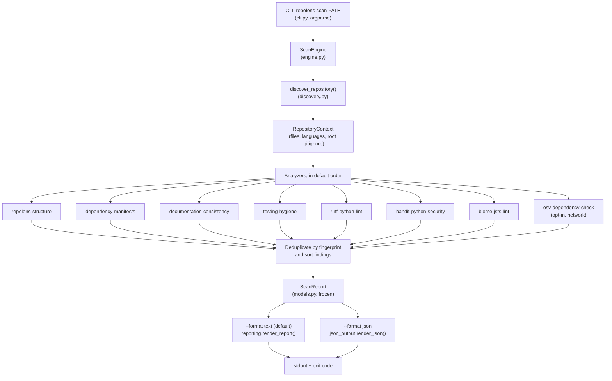
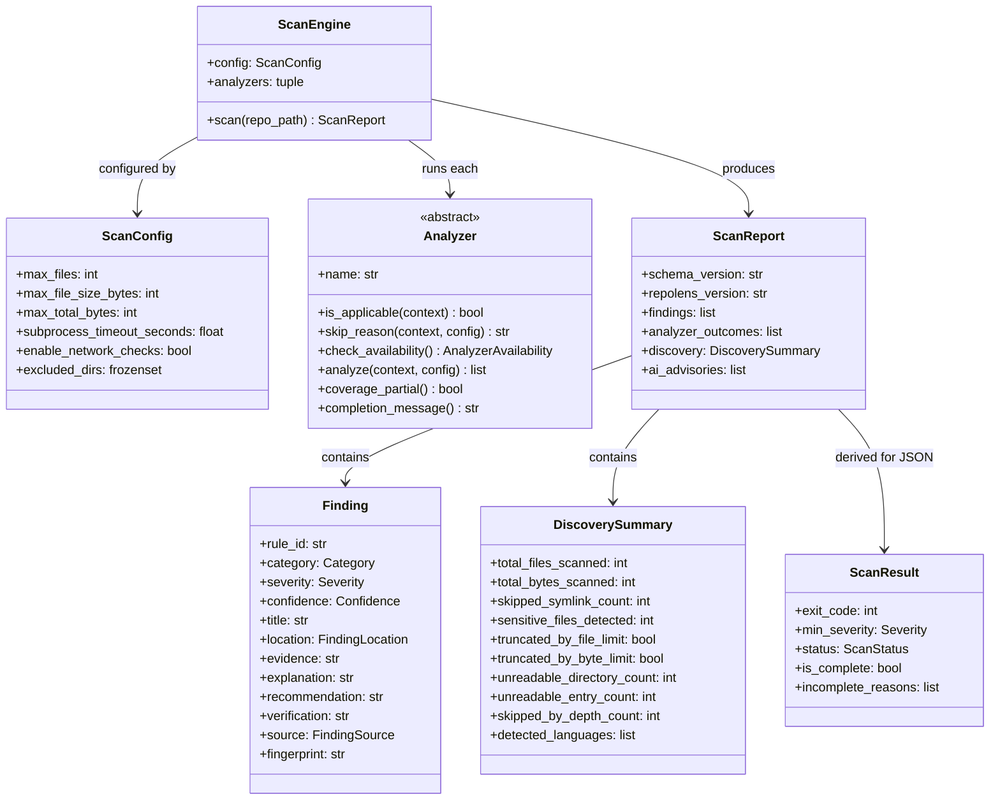
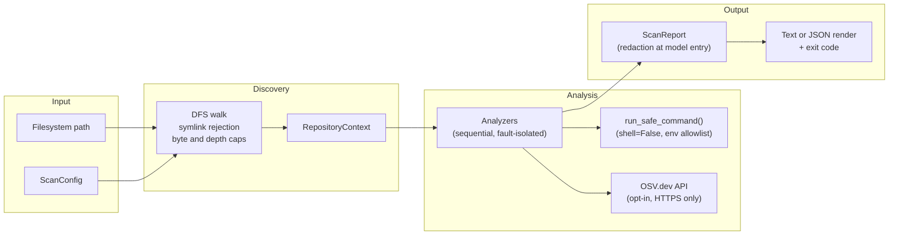

# Architecture

## Overview

RepoLens is a static repository health checker for Python and JavaScript/TypeScript projects. It
accepts a filesystem path, discovers files within configurable resource limits, runs a sequence of
independent analyzers against the discovered content, and returns a structured `ScanReport`. It
never executes or installs anything from the target repository.

Three properties drive the design:

- **Safety** — no code, configuration, or path from the target repository is trusted. See the
  [security model](../security/README.md).
- **Deterministic findings** — for the same repository content and options, findings, their order,
  and their fingerprints are reproducible. Reports as a whole are not byte-identical across runs
  because `scanned_at` and `duration_ms` values vary.
- **Fault isolation** — with the default `ScanConfig(fail_fast=False)`, a failure in one analyzer
  is recorded as that analyzer's outcome and the remaining analyzers still run. Discovery failures
  that prevent a safe walk (for example an entry escaping the canonical root) abort the scan
  before any analyzer runs.

For CLI behavior, exit codes, and the JSON contract this document summarizes, the
[root README](../../README.md) is authoritative.

## Scan pipeline

Both renderers derive their verdict from `reporting.evaluate()`; the CLI's
`determine_exit_code()` uses the same verdict, so text output, JSON `result`, and the process
exit code cannot disagree.

## Module relationships

`ScanResult` is not stored in `ScanReport`. `json_output.build_scan_result()` derives it at
render time and `render_json()` emits it as the document's final `result` member.

## Module overview

### `engine.py` — `ScanEngine`

`ScanEngine(config=None, analyzers=None)` defaults to `ScanConfig()` and
`default_analyzers()` from `analyzers/__init__.py`. `scan(repo_path)`:

1. Calls `discover_repository(target, config)`, which returns a `RepositoryContext`.
2. Runs each analyzer through the lifecycle below, collecting `Finding` objects and one
   `AnalyzerOutcome` per analyzer.
3. Deduplicates findings by fingerprint and sorts them by severity rank, category, path, line,
   rule ID, and fingerprint.
4. Returns a frozen `ScanReport`. `analyzer_outcomes` is a list in analyzer order.

### Analyzer lifecycle (per analyzer)

Applicability and availability probing are themselves isolated: an exception there records a
`failed` outcome (or propagates if `fail_fast` is set) and the scan continues.

1. `is_applicable(context)` is `False` → outcome `skipped` ("Analyzer not applicable…").
2. `skip_reason(context, config)` returns text (for example OSV checks not opted into) → outcome
   `skipped` with that message. (All three probes run when applicable; a skip reason takes
   precedence over unavailability for the recorded outcome.)
3. `check_availability()` reports unavailable (for example an optional tool is not on `PATH`) →
   outcome `unavailable`. This never-started case does not make the scan incomplete.
4. Otherwise `analyze(context, config)` returns `list[Finding]`; the engine records `completed`
   with `findings_count`, `duration_ms`, `completion_message()`, and `coverage_truncated` copied
   from `coverage_partial()`.
5. `AnalyzerTimeoutError` → `timed_out`; `AnalyzerUnavailableError` raised *after* the check
   started → `unavailable` with `coverage_incomplete=True` (an aborted check: the scan is
   incomplete); any other exception → `failed` (or re-raised if `fail_fast`).

The eight built-in analyzers, in default order, are listed in the
[analyzers package notes](../../src/repolens/analyzers/README.md). The base class is `Analyzer`
in `analyzers/base.py`; only `name` (a read-only property) and `analyze()` are abstract — the
other methods have safe defaults.

### `discovery.py` — safe repository discovery

An iterative depth-first walk (`os.scandir`, entries sorted by name) that returns a
`RepositoryContext`: the canonical root, the sorted tuple of `DiscoveredFile` records, the root
`.gitignore` matcher, skipped-symlink paths (kept on the context; the serialized
`DiscoverySummary` carries only the count), present artifact directories, and the summary itself.

Guarantees and limits:

- Symlinks are never followed: symlinked entries are skipped and counted, and a symlinked
  repository root is rejected unless `ScanConfig(reject_symlink_root=False)` is set
  programmatically. Skipped symlinks alone do not make a scan incomplete.
- File *contents* are read only through `RepositoryContext.read_text()`, which refuses paths
  outside discovery, sensitive files, and oversized files, re-checks for symlinks and root
  escape, and opens with `O_NOFOLLOW` **where the platform provides it** (POSIX). On platforms
  without `O_NOFOLLOW` (notably Windows) the symlink and canonical-root checks still apply, but
  the kernel-level TOCTOU guarantee does not. External tools open the files they are given
  themselves; they receive only paths that already passed discovery.
- Sensitive filenames (`.env*` except safe templates such as `.env.example`, SSH private keys,
  `.pem`/`.key`/keystore files, credential files) are recorded and counted but their contents are
  never read.
- Only the **root** `.gitignore` is loaded and evaluated. Directories in `excluded_dirs`
  (`.git`, `node_modules`, `.venv`, `dist`, and similar) are never entered.
- Caps: 10,000 files, 1 MiB per file, 50 MiB total counted bytes, and a 64-level walk depth.
  Hitting a file/byte cap or the depth limit, or failing to read directories/entries, is recorded
  in the summary and makes the scan *incomplete* — it can never exit `0`.

### `models.py` — Pydantic v2 data models

All models are frozen (`frozen=True`, `extra="forbid"`). The serialized shape is versioned by
`SCHEMA_VERSION` (currently `1.1.0`), independently of the package version (`repolens_version`).

- **`Finding`** — one deterministic result: `rule_id`, `category`, `severity`, `confidence`,
  `title`, optional `location` (`FindingLocation`: repository-relative POSIX `path`, optional
  lines/column), optional `evidence` (redacted by a field validator), `explanation`,
  `recommendation`, `verification`, `source` (`FindingSource`: `kind`, `tool`, optional
  `tool_version`/`rule_url`), and `fingerprint` (auto-generated; see the
  [rules reference](../rules/README.md#finding-fingerprints)). `source.kind` must be
  `deterministic`.
- **`AIAdvisory`** — structurally separate, non-authoritative suggestions for the future opt-in
  Stage 4 feature; `source.kind` must be `ai_advisory`. Never merged into `findings`.
- **`AnalyzerOutcome`** — `analyzer_name`, `status` (`completed`, `skipped`, `unavailable`,
  `timed_out`, `failed`), `findings_count`, `duration_ms`, redacted optional `message`, and the
  `coverage_truncated` / `coverage_incomplete` flags described above.
- **`DiscoverySummary`** — counts and truncation/unreadable/depth flags from the walk, plus
  `detected_languages`. Derived properties (`has_discovery_failures`, `depth_limited`,
  `is_partial`) are not serialized fields.
- **`ScanReport`** — `schema_version`, `repolens_version`, `repository_name`, `scanned_at` (UTC),
  `duration_ms`, `discovery`, `analyzer_outcomes` (list), `findings` (list), `ai_advisories`
  (list).
- **`ScanResult`** — the derived JSON verdict (`exit_code`, `min_severity`, `status`,
  `has_findings`, `is_complete`, `incomplete_reasons`, totals, and complete zero-inclusive count
  maps). Emitted only by the JSON renderer.

`ScanConfig` (in `config.py`) is likewise a frozen Pydantic model holding every limit and toggle.

### `analyzers/` and `analyzers/tooling.py`

Analyzer modules and their rule prefixes are catalogued in the
[analyzers package notes](../../src/repolens/analyzers/README.md) and the
[rules reference](../rules/README.md). External-tool analyzers (Ruff, Bandit, Biome) share
`tooling.py`: availability probing on a sanitized `PATH` (running only the tool's `--version`),
selection of eligible discovered files (not sensitive, not oversized, not ignored by the root
`.gitignore`, capped by `max_tool_files`, batched by `tool_batch_size`), disposable tool
workspaces outside the repository, mapping tool-reported paths back inside the root (outside
paths are dropped), and translation of execution failures into the analyzer exception types.

### `dependencies.py` — manifest and lockfile parsing

Shared, defensive parsing of Python and npm manifests/lockfiles into a dependency inventory used
by both the dependency analyzer and the OSV analyzer. Supported formats and their limitations
(for example best-effort `pnpm-lock.yaml`, unparsed `bun.lock*`, `setup.py` never executed or
audited) are listed in the README's "Dependency analysis details". Untrusted JSON/TOML/INI is
parsed defensively, including pathological nesting.

### `osv.py` — OSV.dev client

HTTPS-only client for `api.osv.dev` (`/v1/querybatch`, then `/v1/vulns/<id>` for details), with
redirects rejected, per-request and total timeouts, a response-size ceiling, batches of at most
100 coordinates, and package/advisory caps from `ScanConfig`. Only `name`, `version`, and
`ecosystem` are transmitted. Used only when network checks are opted into.

### `cli.py` — command-line interface

A thin `argparse` front end over `ScanEngine`: `repolens scan [PATH]` with `--min-severity`,
`--max-findings` (text table only), `--format {text,json}`, `--color {auto,always,never}`, and
`--network-checks`; `--version` exists only at the top level, `--help` at both levels. Running `repolens` with no command
prints help and exits `2`. Exit codes are `0` clean, `1` findings at/above threshold (taking
precedence over incompleteness), `2` nothing scanned, `3` incomplete/operational failure, `130`
interrupted — identical for both formats, including when `--format json` writes no document
because no report was produced (diagnostics go to stderr, stdout stays empty).

### `reporting.py` and `json_output.py` — output formats

These are function modules; there is no reporter class.

- `reporting.evaluate(report, min_severity)` returns a `ScanVerdict`: findings at/above the
  threshold, complete severity counts, and every incompleteness signal (failed/timed-out
  analyzers, partial-coverage analyzers, aborted checks, discovery failures/truncation/depth).
- `reporting.render_report(report, options, target_path, exit_code)` renders the terminal report.
  Only findings at/above `RenderOptions.min_severity` appear as table rows (capped by
  `max_findings`); the summary always counts every finding.
- `json_output.render_json(report, exit_code, min_severity)` emits one ASCII-only JSON document:
  `ScanReport.model_dump(mode="json")` plus the derived `result` member. JSON always contains
  **every** finding (`--max-findings` does not apply) and is never colorized.
  `json_output.parse_json_document()` reads a complete document back into models, enforcing the
  schema-version acceptance policy (`SUPPORTED_SCHEMA_MAJOR_VERSIONS`) and, with
  `strict=False`, ignoring unknown *members* while still refusing unknown *values*
  (`UnsupportedSchemaValueError`). The full contract is in the README's
  "Machine-readable JSON output" section; see also
  [ADR-006](../adr/ADR-006-versioned-json-output.md).

### `redaction.py` — secret redaction

`redact_secrets(text, max_length=500)` scrubs, in order: PEM private-key blocks/headers;
known-prefix tokens (GitHub, AWS access key IDs, Google/Gemini, Anthropic/OpenAI/Stripe keys,
Slack, PyPI/npm tokens, JWTs); credential-bearing URLs; `Authorization` header values; and
generic quoted/unquoted secret assignments (with safe placeholders such as `changeme` left
intact). It then truncates to `max_length`. Redaction runs at model entry for `Finding.evidence`
and `AnalyzerOutcome.message`, and explicitly for CLI error text and subprocess stderr
(`SubprocessResult.redacted_stderr()`). It is a defense-in-depth scrub of those fields, not a
guarantee that arbitrary free text elsewhere is secret-free — which is why sensitive files are
never read in the first place. `contains_secret()` exposes the same patterns as a predicate.
Because JSON is serialized from the same models, redacted fields stay redacted in JSON.

### `subprocess_runner.py` — hardened subprocess execution

`run_safe_command()` is the single execution path for external tools:

- `subprocess.Popen(..., shell=False)` with a validated argument list (a shell string is
  rejected outright); the executable is resolved on the sanitized `PATH`.
- Environment is an allowlist only (`PATH`, `LANG`, `LC_ALL`, `LC_CTYPE`, `HOME`, `TMPDIR`,
  `TEMP`, `TMP`, `SYSTEMROOT`, `PATHEXT`) plus forced safe values (`CI=1`, `NO_COLOR=1`,
  `TERM=dumb`, `GIT_TERMINAL_PROMPT=0`, `PIP_DISABLE_PIP_VERSION_CHECK=1`,
  `PYTHONDONTWRITEBYTECODE=1`, `NODE_NO_WARNINGS=1`). Callers may add explicit variables via
  `extra_env`, which is validated.
- `cwd` must be an existing, non-symlink directory; analyzers pass a disposable tool workspace
  outside the repository (see `tooling.tool_workspace()`), never the repository itself.
- stdout and stderr are each capped separately at `subprocess_max_output_bytes` (5 MiB by
  default); truncation is flagged on the result.
- Timeouts terminate the whole tree: POSIX uses a new session and `killpg` (`SIGTERM`, then
  `SIGKILL`); Windows uses a new process group plus `taskkill /F /T /PID` with a `kill()`
  fallback, so a `cmd.exe` `.cmd`-shim wrapper cannot leave the real tool running.

## Data flow

## Security boundaries

Summarized here; the [security model](../security/README.md) is the detailed reference.

- **Filesystem:** discovery never executes, imports, or evaluates target files and never follows
  symlinks; contents are read only via `read_text()` with the checks and platform-scoped
  `O_NOFOLLOW` behavior described above. Repository tool configuration is not loaded (Ruff runs
  `--isolated`; Bandit and Biome run from a disposable workspace, Biome with a RepoLens-generated
  config passed via `--config-path`).
- **Process:** tools run with structured arguments, a sanitized environment, a disposable working
  directory outside the repository, and time/output limits with whole-tree timeout termination.
- **Network:** disabled by default. With `--network-checks`, only HTTPS to `api.osv.dev` (no
  redirects), transmitting only package coordinates.
- **Output:** evidence and outcome/error messages are redacted before storage, so both the
  terminal report and the JSON document are built from already-redacted models.

## Resource limits (defaults in `ScanConfig`)

| Limit | Field | Default |
| --- | --- | --- |
| Maximum files discovered | `max_files` | 10,000 |
| Maximum size per file | `max_file_size_bytes` | 1 MiB |
| Maximum total counted bytes | `max_total_bytes` | 50 MiB |
| Maximum walk depth | `MAX_DIRECTORY_DEPTH` (discovery constant) | 64 |
| Evidence truncation (model validators) | *(fixed in `models.py`)* | 500 chars |
| Subprocess timeout | `subprocess_timeout_seconds` | 30 s |
| Subprocess output cap (per stream) | `subprocess_max_output_bytes` | 5 MiB |
| Files per external tool | `max_tool_files` | 2,000 |
| Tool batch size | `tool_batch_size` | 200 |
| Findings per analyzer | `max_findings_per_analyzer` | 200 |
| Network timeout (per request) | `network_timeout_seconds` | 10 s |
| Network response cap | `max_network_response_bytes` | 2 MiB |
| OSV packages queried | `max_osv_packages` | 300 |
| OSV advisories fetched | `max_osv_advisories` | 50 |

The CLI always uses these defaults (plus `--network-checks`); other values require the
programmatic API. Two `ScanConfig` fields are currently defined but **not read** anywhere —
`enable_external_tools` (tool participation is governed by applicability, availability, and
`skip_reason()`) and `max_evidence_chars` (evidence truncation is fixed at 500 chars by the model
validators). They are documented here so nobody mistakes setting them for behavior changes;
wiring them up or removing them is a code decision for a future change, noted in the audit
report rather than silently altered by documentation.

## Extension points

- **New analyzer:** subclass `Analyzer`, implement `name` and `analyze()`, choose a stable rule
  prefix, add tests, and register the instance in `default_analyzers()`
  (`analyzers/__init__.py`) for the default suite. `ScanEngine(analyzers=[...])` also accepts any
  explicit sequence for embedding. Step-by-step: [contributing guide](../contributing/README.md).
- **Custom limits/toggles:** construct `ScanConfig` and pass it to `ScanEngine`.
- **Programmatic use:** `ScanEngine`, `ScanConfig`, the report models, schema-version constants,
  and scan-document exceptions are exported from `repolens`; renderers live in
  `repolens.reporting` and `repolens.json_output`.
- **AI advisories (Stage 4, planned):** `AIAdvisory` and the deterministic/advisory separation
  already exist in the schema; no AI integration is implemented yet.
